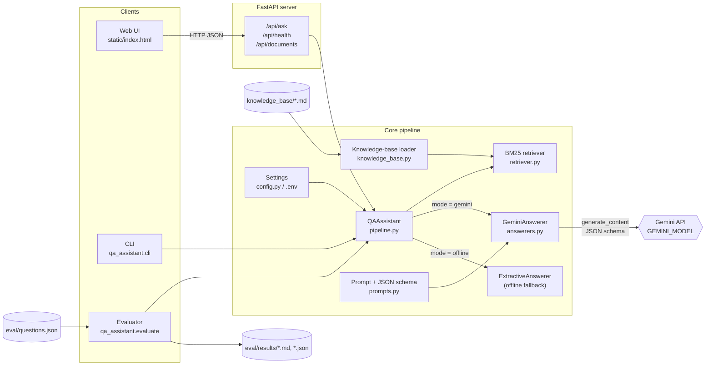
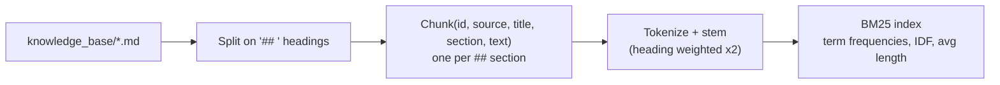
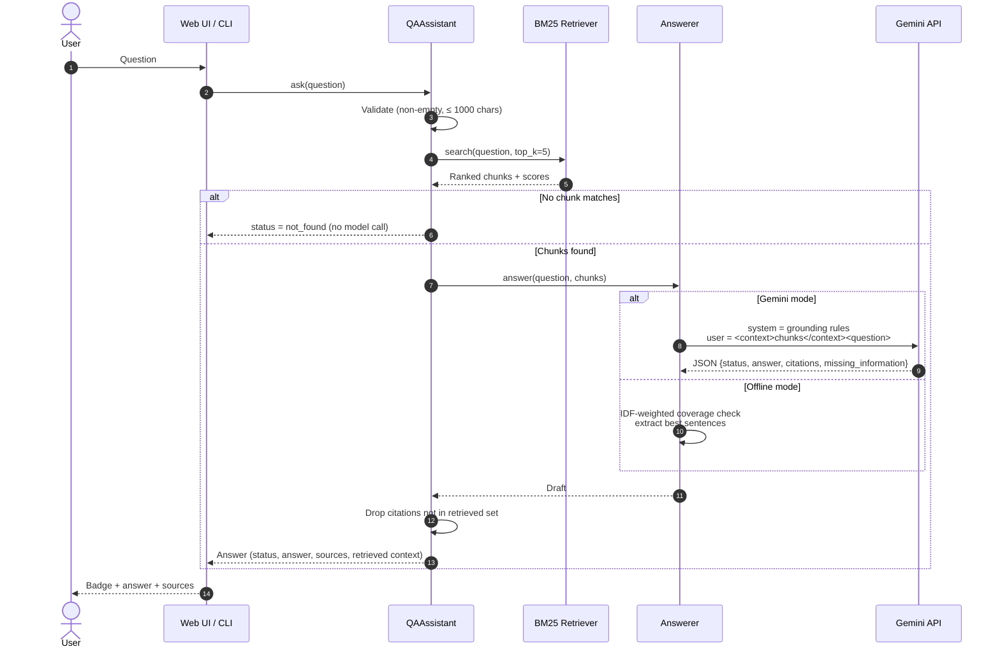
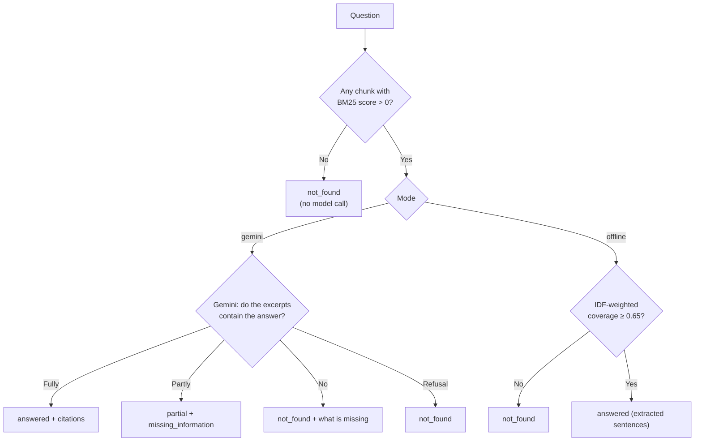

# Architecture and Data Flow

Diagrams use [Mermaid](https://mermaid.js.org/); GitHub and VS Code (with a Mermaid extension) render them automatically.

## 1. Architecture diagram

**Components**

| Component | Responsibility |
|---|---|
| Web UI / CLI / Evaluator | Three front-ends over the same `QAAssistant.ask()` call. |
| FastAPI server | Validates requests, maps errors to HTTP codes, serves the UI. |
| Knowledge-base loader | Splits Markdown files into section chunks with stable ids. |
| BM25 retriever | Ranks chunks for a question; returns top-k with scores. |
| Prompt module | Grounding system prompt, context formatting, answer JSON schema. |
| GeminiAnswerer | One Gemini `generate_content` call with the system prompt, context and JSON schema; handles safety blocks/errors. |
| ExtractiveAnswerer | No-LLM baseline: coverage check + sentence extraction. |
| Pipeline | Orchestrates the steps and verifies citations. |

## 2. Data flow model

### 2.1 Start-up (ingestion)

### 2.2 Question answering (per request)

### 2.3 Data at each stage

| Stage | Data | Example |
|---|---|---|
| Input | question string | `"Can employees carry forward more than 10 days of leave?"` |
| Tokens | stemmed terms + synonyms | `employee carry forward 10 day leave` |
| Retrieval | `[(chunk_id, score)]` | `leave_policy#carry-forward-of-annual-leave 17.4`, `leave_policy#sick-leave 10.4`, … |
| Prompt | system rules + `<context>` + `<question>` | see [prompt_design.md](prompt_design.md) |
| Model output | JSON per `ANSWER_SCHEMA` | `{"status":"answered","answer":"No…","citations":["leave_policy#carry-forward-of-annual-leave"],"missing_information":""}` |
| Response | `Answer` JSON | adds sources' text, scores, mode, latency, notes |

### 2.4 Decision logic for "answer not available"

