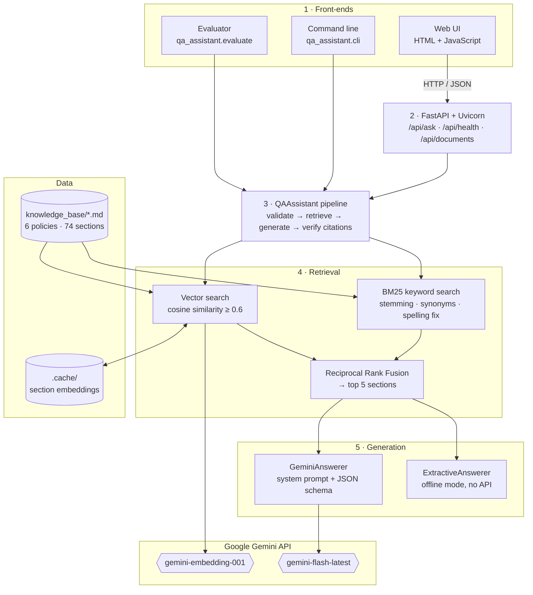
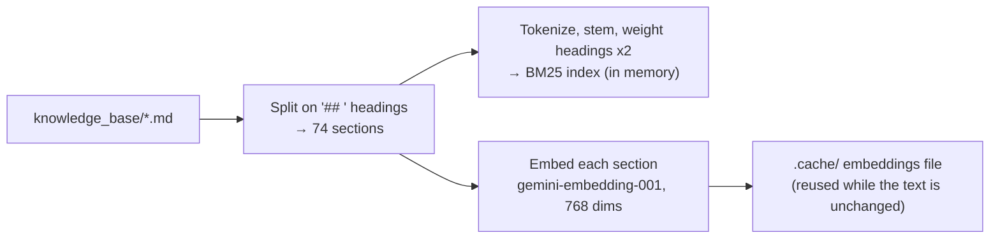
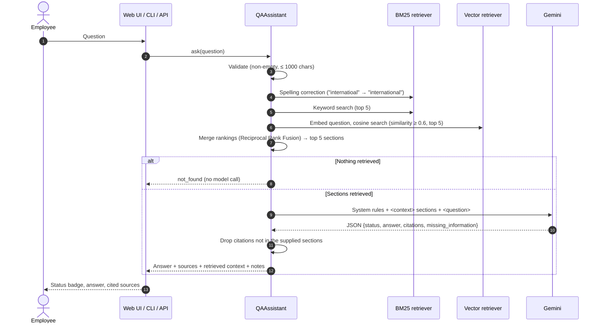

# Context-Aware Q&A Assistant — Project Submission

| | |
|---|---|
| Project | Context-aware policy Q&A assistant with retrieval-augmented generation (RAG) |
| Repository | <https://github.com/ranakaushik/context-aware-qa> |
| Author | Kaushik Rana |
| Date | 27 October 2026 |

---

## 1. Problem Statement

Employees regularly need answers to questions about company policy: *How many days of leave can I carry forward? What is the per diem for an international trip? Can I work from another country?* The answers exist, but they are spread across long policy documents (leave, expenses, remote work, IT security, benefits, conduct), so finding them is slow, and the HR team spends time answering the same questions repeatedly.

A general-purpose chatbot is not a safe replacement, for three reasons:

1. **It answers from its training data, not from the company's rules.** Asked about carry-forward leave, it gives a typical industry answer that may contradict this company's policy.
2. **It makes things up when it doesn't know.** For a question the policies don't cover (for example, stock options), it tends to invent a plausible answer instead of saying so. Because employees act on these answers, an invented policy is worse than no answer.
3. **It gives no evidence.** The employee can't see which policy an answer came from, so they can't check it.

Employees also don't use the policy's own wording. They write "vacation" instead of "annual leave", "DA" instead of "per diem", and they make typos ("per dem for internatioal trip"). Plain keyword search misses these questions.

**Goal:** build a question-answering system that

- answers **only** from a supplied knowledge base (here, the handbook of a fictional Indian company, *Northwind Labs India*: amounts in ₹ with lakh grouping, distances in km, Indian statutory benefits);
- **cites the policy section** behind every answer;
- **clearly says when the answer is not in the knowledge base**, or is only partly there, instead of guessing;
- understands everyday wording, synonyms and typos;
- is usable through a web UI, a command line and an HTTP API, and its accuracy can be measured.

**Success criteria**

| Criterion | Measure |
|---|---|
| Grounded answers | Answerable questions answered correctly, from the knowledge base |
| No hallucination | Questions with no answer in the knowledge base are declined (target: 0% hallucination) |
| Traceability | Every answer cites a section that was actually supplied to the model |
| Retrieval quality | The right policy document is among the retrieved sections |
| Measurability | A fixed evaluation set (48 questions, 13 of them unanswerable) with an automated grader |

---

## 2. Solution, Pipeline and Architecture

### 2.1 Proposed solution

The system uses **retrieval-augmented generation (RAG)**. Instead of letting a language model answer from memory, each question goes through two steps:

1. **Retrieve.** Find the few policy sections most relevant to the question, using **hybrid search**: keyword search (BM25) and meaning-based search (Gemini embeddings), with the two rankings merged.
2. **Generate.** Send only those sections to **Google Gemini** with strict instructions: answer only from these excerpts, cite them, and report `not_found` if they don't contain the answer. The model must reply in a fixed JSON format (`answered` / `partial` / `not_found`, answer text, citations, missing information).

Several safeguards come before and after the model call:

- **Off-topic short-circuit:** if no section shares a key term with the question *and* none is close in meaning, the system answers "not found" without calling the model (no cost, no chance of hallucination).
- **Citation verification:** any citation the model returns that was not among the supplied sections is removed, and the user is warned.
- **Offline mode:** without an API key, a rule-based extractive answerer returns the best-matching sentences, or "not found" when the match is weak, so the system still works (as a baseline) with no external service.

### 2.2 Architecture

| Component | Role |
|---|---|
| Web UI, CLI, Evaluator | Three front-ends over the same `QAAssistant.ask()` call. |
| FastAPI server | Validates requests, maps errors to HTTP status codes, serves the web UI. |
| Knowledge-base loader | Splits each Markdown policy into sections ("chunks") with stable ids such as `leave_policy#carry-forward-of-annual-leave`. |
| BM25 retriever | Keyword ranking with stemming, synonyms ("vacation" → leave) and spelling correction. |
| Vector retriever | Meaning-based ranking: cosine similarity between the question's embedding and each section's embedding. |
| Rank fusion | Merges the two rankings into one list of the top 5 sections. |
| Prompt module | Grounding rules (system prompt), context formatting and the answer JSON schema. |
| GeminiAnswerer | Calls Gemini once per question and parses the structured answer; handles safety blocks and API errors. |
| ExtractiveAnswerer | No-LLM fallback: coverage check plus sentence extraction. |
| Pipeline (`QAAssistant`) | Runs the steps in order and verifies citations. |
| Settings (`config.py`, `.env`) | Model names, mode (`auto` / `gemini` / `offline`), retrieval (`hybrid` / `keyword`), top-k, similarity floor. |

### 2.3 End-to-end pipeline

**A. Indexing (once, at start-up and on the first question)**

**B. Answering a question**

**Stage by stage**

| # | Stage | What happens | Model / library / tool | Role |
|---|---|---|---|---|
| 1 | Ingestion | Read Markdown files; split into one chunk per `##` section with id, document title, section heading and text. | Python standard library (`pathlib`, `re`) | Turns policy documents into retrievable units with citable ids. |
| 2 | Keyword index | Tokenize, remove stopwords, stem, expand synonyms; build term frequencies and IDF. Headings count double. | Custom BM25 in pure Python (k1 = 1.5, b = 0.75) | Exact-term matching: figures, policy names, band letters ("Band A"). |
| 3 | Vector index | Embed every section (`RETRIEVAL_DOCUMENT`), normalize, cache on disk keyed by a SHA-256 of the text. | **Gemini `gemini-embedding-001`** (768 dimensions) via `google-genai` SDK | Meaning-based matching that keyword search misses ("food when travelling abroad" → per diem). |
| 4 | Query processing | Validate length; correct misspellings against the knowledge-base vocabulary. | `difflib` (standard library) | Handles typos; tells the user what was searched. |
| 5 | Hybrid retrieval | BM25 search on the corrected query; embedding search (`RETRIEVAL_QUERY`) on the question as typed, keeping sections with cosine similarity ≥ 0.6. | BM25 + Gemini embeddings | Two complementary candidate lists. The similarity floor keeps off-topic questions (~0.5) out. |
| 6 | Rank fusion | Reciprocal Rank Fusion: score = Σ 1 / (60 + rank); keep the top 5. | Custom code | Combines rankings with different score scales; sections found by both searches rise to the top. |
| 7 | Off-topic gate | If no section is retrieved, return `not_found` immediately. | Pipeline logic | Saves the API call and removes any chance of a hallucinated answer. |
| 8 | Prompt construction | System prompt with grounding rules; user message wraps sections in `<context>` with their ids, followed by the `<question>`. | `prompts.py` | Restricts the model to the excerpts, defines statuses, keeps ₹ formatting, resists prompt injection. |
| 9 | Generation | One call with `response_mime_type = application/json` and a JSON schema. | **Google Gemini `gemini-flash-latest`** via `google-genai` SDK | Reads the excerpts and writes a short answer, a status and citations. |
| 10 | Post-processing | Parse JSON; map safety blocks to `not_found`; drop citations not in the supplied sections; add notes; measure latency. | Python `json`, dataclasses | Guarantees every cited source is real and traceable. |
| 11 | Delivery | Return the answer as JSON; render a status badge, answer, sources and retrieved context. | **FastAPI**, **Uvicorn**, **Pydantic**; HTML/CSS/JavaScript | Makes the system usable by employees and other programs. |
| 12 | Offline fallback | Without an API key: IDF-weighted coverage check (≥ 0.65) and best-sentence or table extraction; keyword retrieval only. | Custom code | Works with no external service; serves as a baseline. |
| 13 | Evaluation | Run 48 questions (35 answerable, 13 unanswerable); grade by expected keywords and status; write JSON and Markdown reports. | `qa_assistant.evaluate`, **pytest** (27 automated tests) | Measures accuracy, hallucination rate and retrieval hit rate. |

### 2.4 Models, libraries, frameworks and tools

| Category | Name | Used for |
|---|---|---|
| Large language model | **Google Gemini** `gemini-flash-latest` (configurable via `GEMINI_MODEL`) | Grounded answer generation with structured JSON output |
| Embedding model | **Google Gemini** `gemini-embedding-001`, 768 dimensions | Semantic (vector) search over policy sections |
| LLM SDK | `google-genai` | Calls to the Gemini generation and embedding APIs |
| Retrieval | Custom **BM25** and **Reciprocal Rank Fusion** (pure Python) | Keyword ranking and hybrid merging; no external search engine or vector database needed at this size |
| Web framework | **FastAPI** with **Pydantic** | JSON API (`/api/ask`, `/api/health`, `/api/documents`) and request validation |
| Web server | **Uvicorn** | ASGI server running the FastAPI app |
| Front-end | HTML, CSS, vanilla JavaScript (`static/index.html`) | Chat-style web UI showing status, answer, sources and context |
| Configuration | `python-dotenv` | Reads settings and the API key from `.env` |
| HTTP client | `httpx` | Used by the SDK and the API tests |
| Testing | **pytest**, FastAPI `TestClient` | 27 tests; Gemini and embeddings are faked, so no API key is needed |
| Evaluation | `qa_assistant.evaluate` + `eval/questions.json` | Accuracy, hallucination and retrieval metrics |
| Language | Python 3.10+ | Entire back-end |
| Deployment | **Render** (`render.yaml`), **Docker** (`Dockerfile`) | Free cloud hosting; see `DEPLOYMENT.md` |
| Version control | Git, GitHub | Source hosting and automatic deploys |

### 2.5 How the design meets the problem

| Problem | How it is solved |
|---|---|
| Model answers from general knowledge | Only retrieved excerpts are sent, and the system prompt forbids outside knowledge. |
| Hallucination when the answer is missing | Explicit `not_found` / `partial` statuses in the JSON schema; off-topic gate skips the model entirely. |
| No evidence | Every answer lists its source sections; citations not in the supplied context are removed. |
| Everyday wording and typos | Embedding search for meaning, synonym map, spelling correction. |
| Exact figures and names | BM25 keyword search keeps precise matches ("Band B", "₹25,000"). |
| Availability and cost | Embeddings cached on disk; no vector database; offline mode without an API key; free hosting. |

### 2.6 Results

Offline baseline (no LLM, keyword retrieval) on the 48-question evaluation set, from `eval/results/results_offline.md`:

| Metric | Value |
|---|---|
| Overall accuracy | 93.8% |
| Answerable questions answered correctly | 91.4% (32 of 35) |
| Unanswerable questions correctly declined | 100% (13 of 13) |
| Hallucination rate | 0% |
| Retrieval hit rate (right document retrieved) | 100% |

With hybrid retrieval, the retrieval hit rate on this set stays at 100% (35 of 35). On everyday wording outside the set, the relevant section moves up the ranking or appears where keyword search alone missed it. Examples: "How much do I get for food when travelling abroad?" now retrieves the international per diem section; "My dad is in hospital, can I take time off?" now retrieves sick leave.
